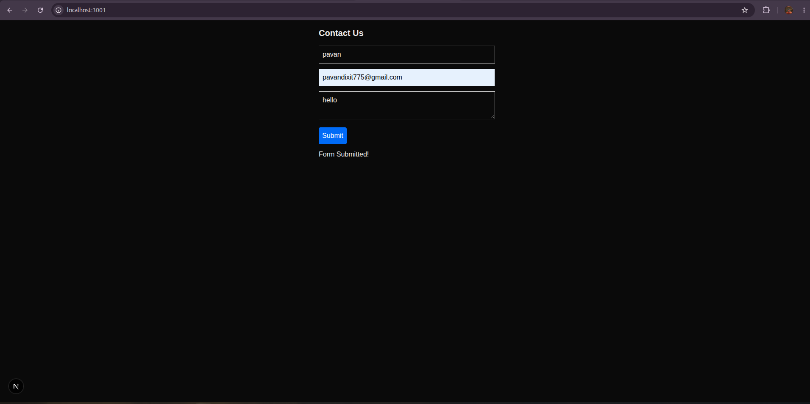
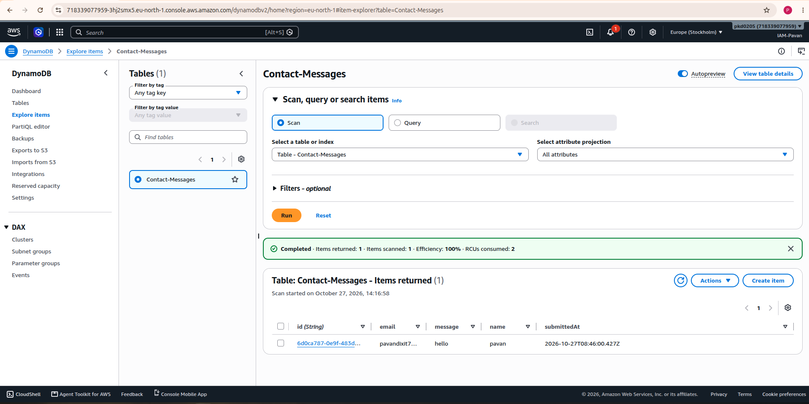
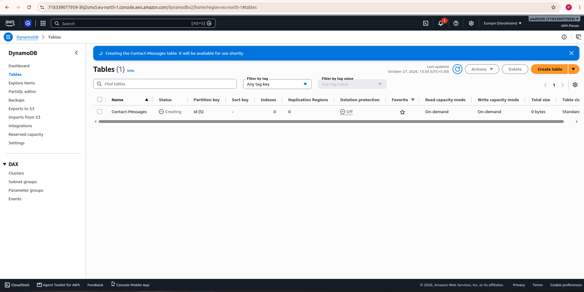

This is a [Next.js](https://nextjs.org) project bootstrapped with [`create-next-app`](https://nextjs.org/docs/app/api-reference/cli/create-next-app).

## Getting Started
# Next.js Contact Form with Amazon DynamoDB

A full-stack contact form built with **Next.js, Node.js, TypeScript, and Amazon DynamoDB**. Users submit their name, email, and message through a web form; the Next.js API route processes the request and stores the submitted data in DynamoDB.

> This README is based on the repository structure provided. Verify the actual table name, key schema, AWS Region, environment variables, and API implementation in `app/api/submit/route.ts` before running the project.

## Features

- Contact form built with Next.js.
- Server-side API endpoint using the Next.js App Router.
- TypeScript application structure.
- Amazon DynamoDB integration for storing submissions.
- Submission feedback in the UI.
- Screenshots documenting the form, table, and results.

## Technology Stack

| Technology | Purpose |
|---|---|
| Next.js and React | Web application and user interface |
| Node.js | Server-side JavaScript runtime |
| TypeScript | Type-safe application code |
| Amazon DynamoDB | Managed NoSQL database |
| AWS SDK for JavaScript | AWS service integration, if used by the code |
| CSS | Application styling |
| npm | Dependency management |

## Architecture

```text
User
 |
 v
Next.js Contact Form (app/page.tsx)
 |
 | POST /api/submit
 v
Next.js API Route (app/api/submit/route.ts)
 |
 | Validate/process request and write item
 v
Amazon DynamoDB
 |
 v
API response -> submission status in the UI
```

The API route must run server-side. Never expose AWS credentials in browser-side code.

## Repository Structure

```text
.
├── .gitignore
├── Output-Images/
│   ├── Output-dynamodb.png
│   ├── data-send-dynamodb.png
│   └── table-contact-message.png
├── README.md
├── app/
│   ├── api/
│   │   └── submit/
│   │       └── route.ts
│   ├── favicon.ico
│   ├── globals.css
│   ├── layout.tsx
│   └── page.tsx
├── next.config.ts
├── package-lock.json
├── package.json
├── postcss.config.mjs
├── public/
│   ├── file.svg
│   ├── globe.svg
│   ├── next.svg
│   └── vercel.svg
└── tsconfig.json
```

## Important Files

| File or directory | Purpose |
|---|---|
| `app/page.tsx` | Contact form interface |
| `app/api/submit/route.ts` | Server-side handler for submitted form data |
| `app/layout.tsx` | Root layout |
| `app/globals.css` | Global styling |
| `package.json` | Dependencies and npm scripts |
| `package-lock.json` | Locked dependency versions |
| `.gitignore` | Files and folders excluded from Git |
| `Output-Images/` | Screenshots of the application and AWS results |

## Screenshots

### Contact Form



### DynamoDB Output



### DynamoDB Table



If an image does not render on GitHub, check the exact filename, capitalization, and relative path.

## Prerequisites

- Node.js version supported by the Next.js version in `package.json`.
- npm.
- An AWS account with access to Amazon DynamoDB.
- A DynamoDB table created in the intended AWS Region.
- An IAM identity with permission to write items to the intended table.

## Installation and Setup

### 1. Clone the repository

```bash
git clone <YOUR_GITHUB_REPOSITORY_URL>
cd <YOUR_PROJECT_DIRECTORY>
```

Replace the placeholders with your actual repository URL and directory name.

### 2. Install dependencies

```bash
npm install
```

### 3. Configure AWS access

For local development, configure AWS credentials using a secure method supported by the AWS SDK. If you use AWS CLI, run:

```bash
aws configure
```

Then verify the configured identity:

```bash
aws sts get-caller-identity
```

Use an IAM identity with least-privilege permissions. Never use root-account access keys for application development, and never commit credentials to GitHub.

### 4. Configure environment variables

Inspect `app/api/submit/route.ts` to determine which environment variables the code actually reads. If the application uses environment variables, create `.env.local` in the project root and use the exact names expected by your code.

For example, your code might use:

```dotenv
AWS_REGION=your-aws-region
DYNAMODB_TABLE_NAME=your-table-name
```

These names are examples only; match them to your implementation. Prefer the AWS SDK credential provider chain or an IAM role over hardcoding credentials. Ensure `.env.local` is listed in `.gitignore`.

### 5. Verify the DynamoDB table

1. Open **Amazon DynamoDB** in the AWS Console.
2. Select **Tables** and open the table used by the application.
3. Verify the table name and Region.
4. Check the partition key and any sort key.
5. Confirm that the backend's IAM identity can write items to this table.

The table name, Region, and key attributes must match the implementation in `app/api/submit/route.ts`.

## Run the Application

Start the development server:

```bash
npm run dev
```

Open the URL printed in your terminal. The default Next.js URL is usually:

```text
http://localhost:3000
```

Next.js may choose another port if port 3000 is already in use.

## Test the Contact Form

1. Open the application in your browser.
2. Enter a name, email address, and message.
3. Click **Submit**.
4. Check the success or error feedback.
5. Open the configured DynamoDB table in the AWS Console.
6. Inspect the table items to verify whether the submitted record was stored.

A success message in the browser alone does not prove that the data was persisted. Verify the record in DynamoDB and inspect server logs if a request fails.

## Troubleshooting

### Form submission fails

- Check the browser Developer Tools and Network tab.
- Confirm `/api/submit` returns the expected HTTP status.
- Inspect the terminal running `npm run dev`.
- Ensure the request body matches the fields expected by `route.ts`.

### AWS credentials or permissions error

- Run `aws sts get-caller-identity` to verify the configured identity.
- Confirm credentials are available to the Node.js process.
- Check the IAM permissions for the intended DynamoDB table.
- Verify the AWS Region.

### DynamoDB table or key error

- Check the table name and Region.
- Compare the item's attributes with the table's key schema.
- Ensure required partition-key and sort-key attributes are included.

### Data does not appear in DynamoDB

- Inspect the API response and server logs.
- Confirm the code awaits and handles the DynamoDB write operation.
- Verify you are viewing the correct table and Region.

## Security and Cost Best Practices

- Validate submitted data on the server; client-side validation alone is insufficient.
- Never commit `.env.local`, AWS credentials, passwords, or secrets.
- Never expose AWS credentials in frontend code.
- Apply least-privilege IAM permissions.
- Avoid storing unnecessary personal information.
- Add spam protection and rate limiting before exposing a public form.
- Review DynamoDB capacity, storage, request, and other applicable AWS charges.
- Monitor AWS Billing and Cost Management and remove unused resources.

## Future Improvements

- Stronger server-side validation and input sanitization.
- Improved loading, success, and error states.
- Email notifications through an appropriate service.
- Spam protection.
- An admin view for reviewing messages.
- Automated tests for the API route.
- Secure deployment using an IAM role.
- Monitoring and logging for failed submissions.

## What I Learned

- Building a contact form with Next.js.
- Creating a server-side API route.
- Handling requests with Node.js and TypeScript.
- Connecting a backend to Amazon DynamoDB.
- Understanding AWS access permissions and data persistence.
- Documenting the project with screenshots.

## Author

**Pavan Kumar Dixit**

This project is part of my hands-on learning in **AWS Cloud Computing, serverless application development, and DevOps**.

First, run the development server:

```bash
npm run dev
# or
yarn dev
# or
pnpm dev
# or
bun dev
```

Open [http://localhost:3000](http://localhost:3000) with your browser to see the result.

You can start editing the page by modifying `app/page.tsx`. The page auto-updates as you edit the file.

This project uses [`next/font`](https://nextjs.org/docs/app/building-your-application/optimizing/fonts) to automatically optimize and load [Geist](https://vercel.com/font), a new font family for Vercel.

## Learn More

To learn more about Next.js, take a look at the following resources:

- [Next.js Documentation](https://nextjs.org/docs) - learn about Next.js features and API.
- [Learn Next.js](https://nextjs.org/learn) - an interactive Next.js tutorial.

You can check out [the Next.js GitHub repository](https://github.com/vercel/next.js) - your feedback and contributions are welcome!

## Deploy on Vercel

The easiest way to deploy your Next.js app is to use the [Vercel Platform](https://vercel.com/new?utm_medium=default-template&filter=next.js&utm_source=create-next-app&utm_campaign=create-next-app-readme) from the creators of Next.js.

Check out our [Next.js deployment documentation](https://nextjs.org/docs/app/building-your-application/deploying) for more details.
